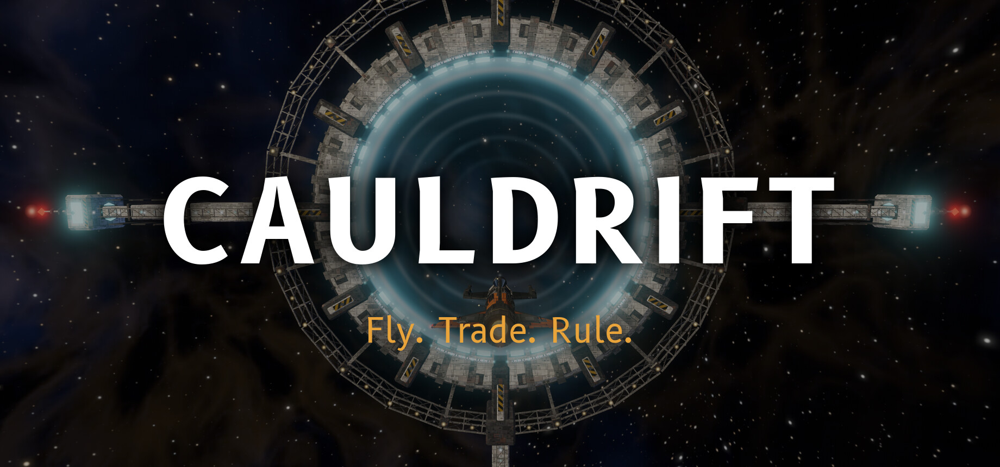
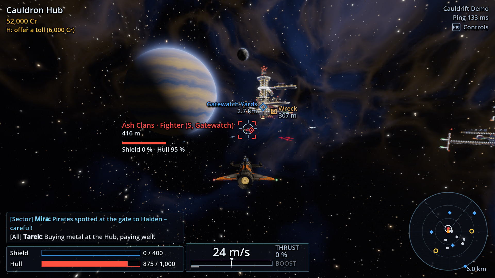
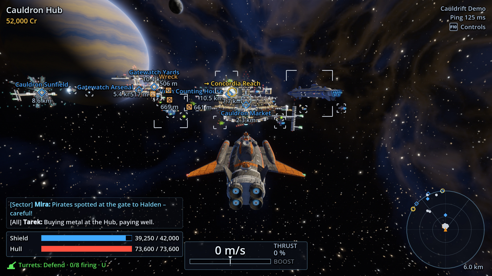
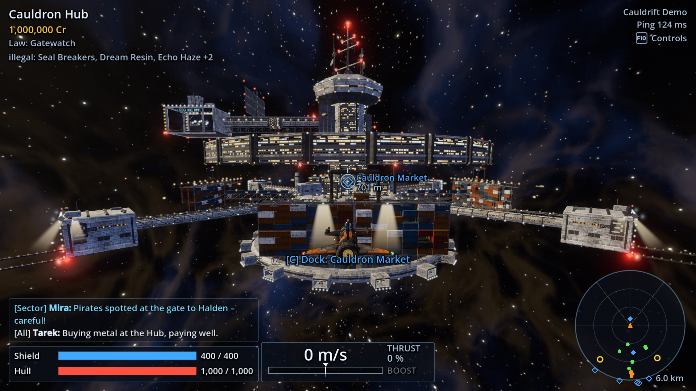
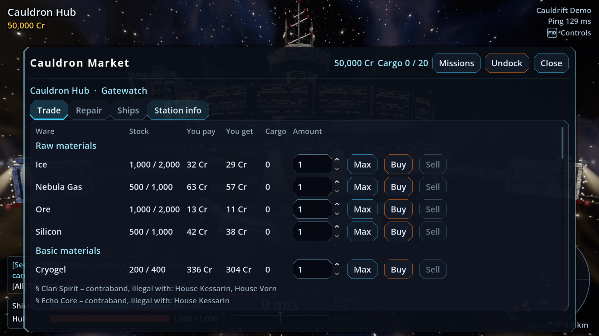
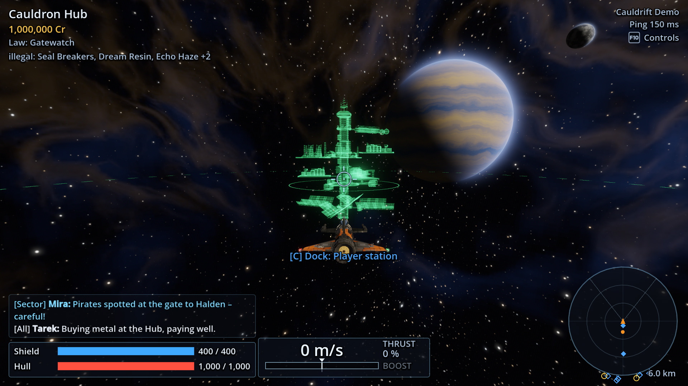
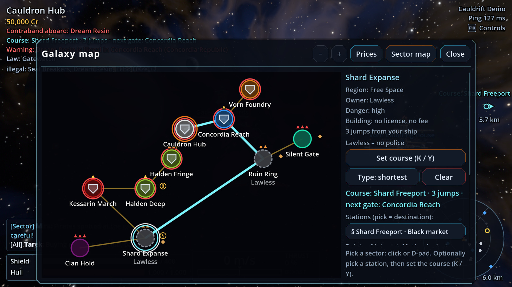

  

  <a href="#english"><b>English</b></a> · <a href="#deutsch"><b>Deutsch</b></a>

  
  
  

| | |
|---|---|
|  |  |
|  |  |
|  |  |

---

## English

**Fly. Trade. Rule.** Cauldrift is a space sandbox for 1–20 players on **your own server**: fly
your ship yourself, trade in an economy with real supply chains, build station complexes and
command fleets from S to XL.

**Free alpha · Windows & Linux · English & German**

[▶ Trailer](https://www.youtube.com/watch?v=GGccSGb2f0E) · [💬 Discord](https://discord.gg/rymrdBjQEq) · [🐞 Bugs & ideas](https://github.com/Cauldrift/cauldrift-builds/issues/new/choose) · [⬇ Download](#download)

### The game

Ten sectors of a dense star cluster, linked by jump gates. Seven factions compete for trade, law
and influence. Your career starts with a small ship, a few credits and a course. And somewhere in
the cluster, the Silence is lurking …

- 🚀 **Fly and fight yourself:** chase and cockpit camera, guns, missiles and turrets
- 📦 **Real supply chains:** 55 wares and 52 recipes, every load is actually flown through space
- 🛸 **Your own fleets:** 40 ships from S to XL, with orders to trade, mine and follow
- 🏗️ **Station complexes:** 61 module types for production, storage and shipyards
- ⚖️ **Law and reputation:** laws, smuggling, black markets and standing with seven factions
- 🌐 **Your server:** a persistent world on Windows or Linux, as PvE, PvP or both
- 🎮 Keyboard/mouse and gamepad, English and German

### Download

| Package | For | Download |
|---|---|---|
| Client Windows | Playing on Windows 10/11 | [Cauldrift-Client-Windows.zip](https://github.com/Cauldrift/cauldrift-builds/releases/latest/download/Cauldrift-Client-Windows.zip) |
| Client Linux | Playing on Linux | [Cauldrift-Client-Linux.zip](https://github.com/Cauldrift/cauldrift-builds/releases/latest/download/Cauldrift-Client-Linux.zip) |
| Server Windows | Hosting a server on Windows | [Cauldrift-Server-Windows.zip](https://github.com/Cauldrift/cauldrift-builds/releases/latest/download/Cauldrift-Server-Windows.zip) |
| Server Linux | Hosting a server on Linux | [Cauldrift-Server-Linux.zip](https://github.com/Cauldrift/cauldrift-builds/releases/latest/download/Cauldrift-Server-Linux.zip) |

These links always point to the newest version. Older versions and release notes:
[Releases](https://github.com/Cauldrift/cauldrift-builds/releases). Checksums:
[SHA256SUMS.txt](https://github.com/Cauldrift/cauldrift-builds/releases/latest/download/SHA256SUMS.txt)
(check with `sha256sum -c SHA256SUMS.txt` on Linux or `certutil -hashfile <file> SHA256` on
Windows).

### Quick start: play

1. Unzip the client package into a folder of your choice.
2. Start the game:
   - **Windows:** `Cauldrift-High.cmd`, or `Cauldrift-Low.cmd` for weaker graphics cards. Windows
     may warn you because the game is not signed: *More info → Run anyway*.
   - **Linux:** `./cauldrift-high.sh`, or `./cauldrift-low.sh` for weaker graphics cards.
3. Enter the server address, click **Register** once, then log in.

There is no single-player mode yet, so you need a server: join one (see the server list on
Discord) or host your own. The full guide is `GAME_GUIDE.md` in the client folder.

### Quick start: host a server

1. Unzip the server package. No graphics card is needed.
2. Start the server: **Linux** `./cauldrift-server.sh`, **Windows** `cauldrift-server.cmd`. It is
   ready when `SERVER BEREIT port=24600` appears.
3. Open port **24600 for UDP and TCP** in your firewall and router.
4. Make yourself admin and set up your rules as described in `STARTING.md` in the server folder.

The full guide is `SERVER_GUIDE.md`. The server package also contains a privacy notice template
(`PRIVACY.md`) for operators.

### Updating

- **Before updating a server,** back up its `saves` folder (the world database).
- Client and server only need to be updated together if the release notes say so. If versions do
  not match, the server tells you when you log in.

### System requirements (preliminary)

- **Client:** Windows 10/11 (64-bit) or Linux (x86_64), a graphics card with Vulkan support, about
  250 MB of disk space. The "Low" start file helps on weaker graphics cards.
- **Server:** Windows or Linux (64-bit), about 250 MB; no graphics card needed. In tests, 20
  players (bots) ran smoothly on an ordinary computer.

### Status

Cauldrift is in an **early alpha**. The graphics are a prototype and will be improved, there is no
single-player mode yet, and balance is still in progress. Your feedback is very welcome:

- **Found a bug?** Please report it on [GitHub Issues](https://github.com/Cauldrift/cauldrift-builds/issues/new/choose) (in English). The form asks for
  everything needed to find the problem.
- **Have an idea?** Suggest it on [GitHub Issues](https://github.com/Cauldrift/cauldrift-builds/issues/new/choose) as well (English or German). If it is
  already there, give it a 👍.
- **Questions and chat:** [Discord](https://discord.gg/rymrdBjQEq).

### Made with AI

The code, game texts and translations were written by the AI Claude (Anthropic). Ships, stations
and many sounds come from procedural generators that Claude wrote; no image generator was used.
The music and some sounds are CC0 works by human creators. Details are shown in the game under
*Options → About & licences*.

### Privacy and age

The game has no telemetry and sends no data to the developer. Servers are run by players; each
server operator is responsible for their server, its rules and its moderation. Recommended age:
**12+** (own assessment; open chat with other players).

### Credits

- **Engine:** [Godot Engine](https://godotengine.org) (MIT),
  [godot-sqlite](https://github.com/2shady4u/godot-sqlite) (MIT),
  [SQLite](https://sqlite.org) (public domain)
- **Music:** Vitalezzz (CC0, via OpenGameArt)
- **Sounds:** CC0 works from Freesound, Kenney and OpenGameArt
- **Textures:** ambientCG and Poly Haven (CC0)
- **Effects:** Unity Labs and Kenney (CC0), Hyrdaboo and nojoule (MIT)

All licence texts are in `THIRD_PARTY_NOTICES.txt` in every download.

### Licence

Cauldrift is free to download and play during the alpha. You may share the unmodified download
packages, for example with friends or on other websites, as long as you do not charge for them.
Cauldrift is not open source; all rights reserved. © 2026 Ulf Hillnhütter

---

## Deutsch

**Fliege. Handle. Herrsche.** Cauldrift ist eine Weltraum-Sandbox für 1–20 Spieler auf **eurem
eigenen Server**: Fliege dein Schiff selbst, handle in einer Wirtschaft mit echten Warenketten,
baue Stationskomplexe und führe Flotten von S bis XL.

**Kostenlose Alpha · Windows & Linux · Deutsch & Englisch**

[▶ Trailer](https://www.youtube.com/watch?v=0rezakc2mUE) · [💬 Discord](https://discord.gg/RgVbdfAKJw) · [🐞 Fehler & Ideen](https://github.com/Cauldrift/cauldrift-builds/issues/new/choose) · [⬇ Herunterladen](#herunterladen)

### Das Spiel

Zehn Sektoren eines dichten Sternhaufens, verbunden durch Sprungtore. Sieben Fraktionen ringen um
Handel, Recht und Einfluss. Deine Laufbahn beginnt mit einem kleinen Schiff, ein paar Credits und
einem Kurs. Und irgendwo im Sternhaufen lauert die Stille …

- 🚀 **Selbst fliegen und kämpfen:** Verfolger- und Cockpitkamera, Kanonen, Raketen und
  Geschütztürme
- 📦 **Echte Warenketten:** 55 Waren und 52 Rezepte, jede Ladung wird wirklich durch den Raum
  geflogen
- 🛸 **Eigene Flotten:** 40 Schiffe von S bis XL, mit Befehlen zum Handeln, Abbauen und Folgen
- 🏗️ **Stationskomplexe:** 61 Modultypen für Produktion, Lager und Werften
- ⚖️ **Recht und Ruf:** Gesetze, Schmuggel, Schwarzmärkte und Ruf bei sieben Fraktionen
- 🌐 **Euer Server:** dauerhafte Welt unter Windows oder Linux, als PvE, PvP oder beides
- 🎮 Tastatur/Maus und Gamepad, Deutsch und Englisch

### Herunterladen

| Paket | Wofür | Download |
|---|---|---|
| Client Windows | Spielen unter Windows 10/11 | [Cauldrift-Client-Windows.zip](https://github.com/Cauldrift/cauldrift-builds/releases/latest/download/Cauldrift-Client-Windows.zip) |
| Client Linux | Spielen unter Linux | [Cauldrift-Client-Linux.zip](https://github.com/Cauldrift/cauldrift-builds/releases/latest/download/Cauldrift-Client-Linux.zip) |
| Server Windows | Eigenen Server unter Windows betreiben | [Cauldrift-Server-Windows.zip](https://github.com/Cauldrift/cauldrift-builds/releases/latest/download/Cauldrift-Server-Windows.zip) |
| Server Linux | Eigenen Server unter Linux betreiben | [Cauldrift-Server-Linux.zip](https://github.com/Cauldrift/cauldrift-builds/releases/latest/download/Cauldrift-Server-Linux.zip) |

Die Links zeigen immer auf die neueste Version. Ältere Versionen und Versionshinweise:
[Releases](https://github.com/Cauldrift/cauldrift-builds/releases). Prüfsummen:
[SHA256SUMS.txt](https://github.com/Cauldrift/cauldrift-builds/releases/latest/download/SHA256SUMS.txt)
(prüfen unter Linux mit `sha256sum -c SHA256SUMS.txt`, unter Windows mit
`certutil -hashfile <datei> SHA256`).

### Schnellstart: Spielen

1. Das Client-Paket in einen beliebigen Ordner entpacken.
2. Das Spiel starten:
   - **Windows:** `Cauldrift-High.cmd`, für schwächere Grafikkarten `Cauldrift-Low.cmd`. Windows
     warnt eventuell, weil das Spiel nicht signiert ist: *Weitere Informationen → Trotzdem
     ausführen*.
   - **Linux:** `./cauldrift-high.sh`, für schwächere Grafikkarten `./cauldrift-low.sh`.
3. Die Serveradresse eingeben, einmal **Registrieren** und danach anmelden.

Einen Einzelspielermodus gibt es noch nicht, du brauchst also einen Server: Tritt einem bei (siehe
Serverliste im Discord) oder betreibe deinen eigenen. Die ausführliche Anleitung ist
`SPIELANLEITUNG.md` im Client-Ordner.

### Schnellstart: Eigener Server

1. Das Server-Paket entpacken. Eine Grafikkarte ist nicht nötig.
2. Den Server starten: **Linux** `./cauldrift-server.sh`, **Windows** `cauldrift-server.cmd`. Er
   ist bereit, sobald `SERVER BEREIT port=24600` erscheint.
3. Port **24600 für UDP und TCP** in Firewall und Router freigeben.
4. Sich selbst zum Admin machen und die eigenen Regeln einrichten, wie in `STARTEN.md` im
   Server-Ordner beschrieben.

Die ausführliche Anleitung ist `SERVER_HANDBUCH.md`. Im Server-Paket liegt außerdem eine Vorlage
für den Datenschutzhinweis (`DATENSCHUTZ.md`) für Betreiber.

### Aktualisieren

- **Vor dem Aktualisieren eines Servers** den Ordner `saves` sichern (die Weltdatenbank).
- Client und Server müssen nur dann gemeinsam aktualisiert werden, wenn es in den
  Versionshinweisen steht. Passen die Versionen nicht zusammen, sagt der Server es bei der
  Anmeldung.

### Systemanforderungen (vorläufig)

- **Client:** Windows 10/11 (64 Bit) oder Linux (x86_64), Grafikkarte mit Vulkan, rund 250 MB
  Speicherplatz. Für schwächere Grafikkarten gibt es die Startdatei „Low“.
- **Server:** Windows oder Linux (64 Bit), rund 250 MB, keine Grafikkarte nötig. Im Test liefen
  20 Spieler (Bots) flüssig auf einem gewöhnlichen Rechner.

### Stand

Cauldrift ist in einer **frühen Alpha**. Die Grafik ist ein Prototyp und wird verbessert, einen
Einzelspielermodus gibt es noch nicht, und an der Balance wird noch gearbeitet. Deine Rückmeldung
ist ausdrücklich willkommen:

- **Fehler gefunden?** Bitte über [GitHub Issues](https://github.com/Cauldrift/cauldrift-builds/issues/new/choose) melden (auf Englisch). Das Formular
  fragt alles ab, was zum Finden des Fehlers nötig ist.
- **Eine Idee?** Ebenfalls über [GitHub Issues](https://github.com/Cauldrift/cauldrift-builds/issues/new/choose) vorschlagen (Deutsch oder Englisch). Gibt es
  sie schon, einfach mit 👍 unterstützen.
- **Fragen und Austausch:** [Discord](https://discord.gg/RgVbdfAKJw).

### Mit KI erstellt

Code, Spieltexte und Übersetzungen schrieb die KI Claude (Anthropic). Schiffe, Stationen und viele
Klänge entstehen aus Generatoren, die Claude geschrieben hat; einen Bildgenerator gibt es nicht.
Die Musik und ein Teil der Klänge sind freie Werke von Menschen (CC0). Details zeigt das Spiel
unter *Optionen → Über & Lizenzen*.

### Datenschutz und Alter

Das Spiel hat keine Telemetrie und sendet keine Daten an den Entwickler. Server betreiben die
Spieler selbst; für Server, Regeln und Moderation ist der jeweilige Betreiber verantwortlich.
Altersempfehlung: **ab 12 Jahren** (eigene Einschätzung; offener Chat mit anderen Spielern).

### Danksagung

- **Engine:** [Godot Engine](https://godotengine.org) (MIT),
  [godot-sqlite](https://github.com/2shady4u/godot-sqlite) (MIT),
  [SQLite](https://sqlite.org) (gemeinfrei)
- **Musik:** Vitalezzz (CC0, über OpenGameArt)
- **Klänge:** CC0-Werke von Freesound, Kenney und OpenGameArt
- **Texturen:** ambientCG und Poly Haven (CC0)
- **Effekte:** Unity Labs und Kenney (CC0), Hyrdaboo und nojoule (MIT)

Alle Lizenztexte stehen in `THIRD_PARTY_NOTICES.txt` in jedem Download.

### Lizenz

Cauldrift ist während der Alpha kostenlos herunterzuladen und zu spielen. Du darfst die
unveränderten Download-Pakete weitergeben, etwa an Freunde oder auf anderen Webseiten, solange du
kein Geld dafür verlangst. Cauldrift ist kein Open Source; alle Rechte vorbehalten. © 2026 Ulf Hillnhütter
